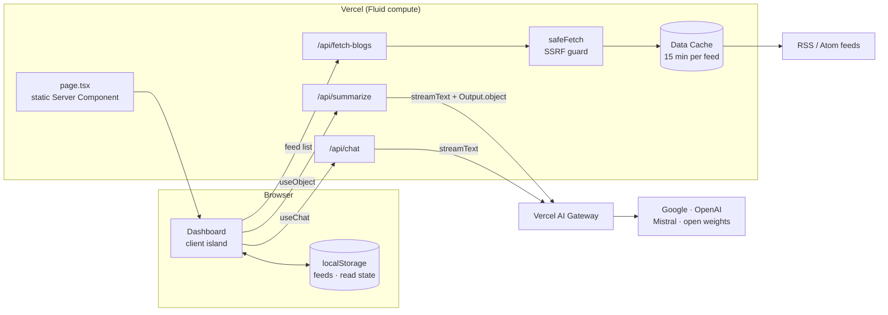

# Summarily

**An AI-powered RSS reader.** Subscribe to blogs, get streaming, structured summaries of each post, and ask follow-up questions grounded in the article.

Built with **Next.js 16 (App Router)**, **React 19**, **TypeScript**, the **Vercel AI SDK**, and **Vercel AI Gateway**.

**Live demo:** [summarily-mu.vercel.app](https://summarily-mu.vercel.app)

---

## Features

- **Streaming structured summaries.** TL;DR, key points, data highlights, caveats, a notable quote, and tone, rendered field by field as the model generates them.
- **Chat with any post.** Streaming Q&A grounded in the article text.
- **Multi-model.** Switch between Google, OpenAI, Mistral, and open-weights models through one gateway with no per-provider SDKs or keys.
- **Feed discovery.** Paste a domain (`overreacted.io`) or a name (`hacker news`) and Summarily finds the feed.
- **Tags, read tracking, and chronological or per-feed views**, all stored locally in the browser.

## Architecture



### Design decisions

| Decision | Why |
|---|---|
| **AI SDK + AI Gateway** (`model: 'google/gemini-2.5-flash-lite'`) | One API across providers, built-in retries and failover, and no provider keys in the app. On Vercel the gateway authenticates with **OIDC**, so production has no LLM secret to manage or leak. |
| **Structured output, streamed** (`streamText` + `Output.object` → `useObject`) | A shared zod schema types the summary end to end. Users see the TL;DR as soon as it's generated instead of waiting for the whole object. This replaced the old hand-written "extract JSON from prose" parsing. |
| **Fail before streaming** | `/api/summarize` waits for the first chunk before sending `200`, so provider errors (quota, auth, unavailable model) return a real `502` rather than an empty stream. |
| **Static shell, client island** | `page.tsx` is a prerendered Server Component, and only the interactive dashboard ships as client JS. The theme is applied by an inline `<head>` script before first paint, with no hide-until-hydrated wrapper blocking LCP. |
| **Parallel, cached feed fetching** | Feeds are fetched with `Promise.allSettled` (one slow or broken feed never blocks the rest) and each response is cached in the Next.js Data Cache for 15 minutes. Repeat loads skip the origin entirely. Tag filtering happens on the client, with no refetch. |
| **localStorage as the store** | There are no accounts and no database, so the demo can be used anonymously. An optional file store (`FEEDS_FILE_STORAGE=true`) exists for single-user local use. |

### Security

Summarily fetches arbitrary user-supplied URLs and sends untrusted text to LLMs, so it is hardened accordingly:

- **SSRF protection** (`lib/url-guard.ts`, `lib/safe-fetch.ts`): http(s) on default ports only, no credentials in URLs, DNS resolution checked against private, loopback, link-local, CGNAT, and cloud-metadata ranges (IPv4, IPv6, IPv4-mapped, and NAT64), every redirect hop re-validated, plus response size and time limits. Covered by unit tests.
- **Cost controls:** a server-side **model allowlist** (the client can't request an expensive model), `maxOutputTokens` caps, input truncation, and per-IP rate limits on every API route.
- **Prompt-injection hardening:** article text is passed inside delimited tags and the model is told to treat it as data, not instructions.
- **Input validation:** every request body is parsed with zod, and error responses never echo upstream internals.
- **Security headers:** `nosniff`, `X-Frame-Options: DENY`, a strict referrer policy, and a permissions policy.

**Known limitations** (deliberate trade-offs for a demo):

- The rate limiter is in-memory per instance. In production I'd add a **Vercel WAF rate-limit rule** on `/api/*`, or back it with Redis.
- DNS is resolved once for validation and again by `fetch`, so a DNS-rebinding attacker could race the two. Fully closing that requires pinning the resolved IP with a custom HTTP agent.

### What I'd do next

- Accounts and a database (e.g. Neon via the Vercel Marketplace) so feeds sync across devices.
- A cron job to pre-warm the feed cache and pre-compute summaries for popular feeds.
- AI SDK telemetry → OpenTelemetry, to track latency, token usage, and cost per model.
- An eval set of articles and reference summaries to compare models on faithfulness before changing the default.

---

## Running locally

Requires Node.js 22+.

```bash
npm install
vercel link          # link to a Vercel project
vercel env pull      # writes a short-lived AI Gateway OIDC token to .env.local
npm run dev          # http://localhost:3000
```

Instead of `vercel env pull`, you can set `AI_GATEWAY_API_KEY` in `.env.local` (see `.env.example`). Feed reading works without any key; only summaries and chat need the gateway.

| Command | Description |
|---|---|
| `npm run dev` | Dev server |
| `npm run build` | Production build |
| `npm run lint` | ESLint |
| `npm run typecheck` | TypeScript |
| `npm test` | Unit tests (`node --test`) |

## Project structure

```
app/
  page.tsx               static Server Component shell
  api/summarize          streaming structured summary (AI SDK)
  api/chat               streaming chat (AI SDK)
  api/fetch-blogs        parallel, cached feed fetching
  api/discover-feeds     feed discovery
  api/validate-feed      feed validation
components/
  Dashboard.tsx          client island: shared state
  posts/PostCard.tsx     useObject summary + chat
  BlogChat.tsx           useChat
lib/
  models.ts              model allowlist
  summary-schema.ts      zod schema shared by server and client
  safe-fetch.ts          SSRF-safe fetch with Data Cache
  url-guard.ts           URL and IP validation (unit tested)
  feeds.ts               RSS/Atom parsing and normalization
  rate-limit.ts          per-IP rate limiting
```

## License

MIT
